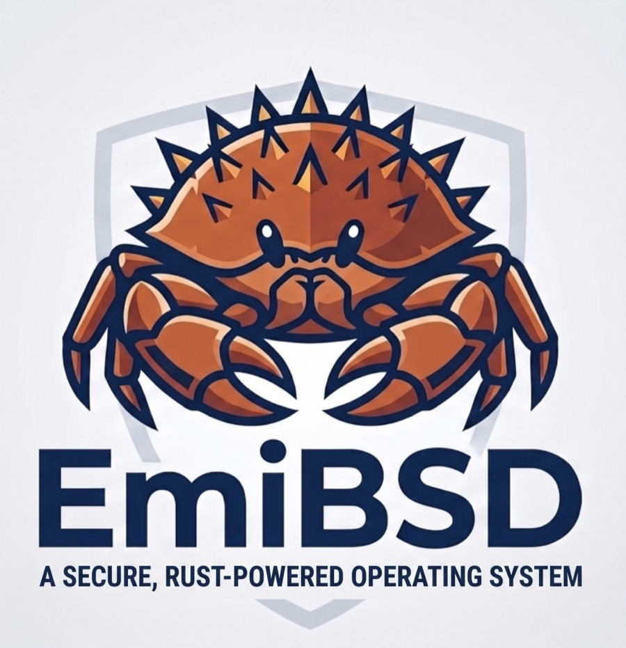
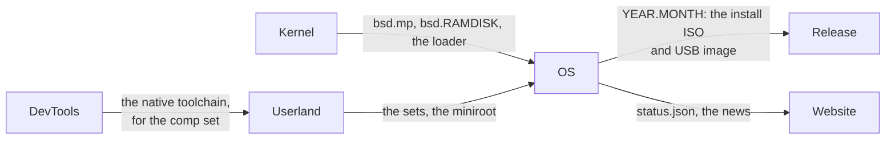

# EmiBSD OS

<p align="center">
  
</p>

<p align="center"><em>Ferffy, the EmiBSD mascot: a <a href="https://en.wikipedia.org/wiki/Lithodes_santolla">centolla</a>, the child of Ferris (Rust's crab) and Puffy (OpenBSD's pufferfish).</em></p>

<p align="center"><strong>Where an EmiBSD system is assembled, booted, compared with OpenBSD and released.</strong></p>

<p align="center">
  <a href="LICENSE"></a>
  <a href="docs/RELEASE.md"></a>
  <a href="https://github.com/EmiBSD/OS/releases/tag/2026.11.3"></a>
  <a href="docs/RELEASE.md"></a>
  <a href="https://www.emibsd.org"></a>
</p>

> **Not for production.** EmiBSD is an experiment. It runs only in QEMU, and its crypto,
> network and storage code is unaudited. Do not use it to protect real data or real networks.

Where an [EmiBSD](https://www.emibsd.org) system is assembled and released. `MANIFEST.toml`
pins one release of each repository that produces part of the system; the recipes fetch them
by tag and sum, make the install media, install them in QEMU, compare the result with a real
OpenBSD and tag the release as `YEAR.MONTH`.

| Pinned | Contributes |
|---|---|
| [Kernel](https://github.com/EmiBSD/Kernel) | `bsd.mp`, the kernel; `bsd.RAMDISK`, the same kernel with an empty ramdisk; the EFI loader `BOOTAA64.EFI` |
| [Userland](https://github.com/EmiBSD/Userland) | the base system above the kernel: its `base`, `comp`, `game` and `man` sets, the installer's ramdisk `miniroot80.fs`, `INSTALL.arm64`; and the host `makefs` its recipes build |
| [DevTools](https://github.com/EmiBSD/DevTools) | nothing directly: its native toolchain (clang, lld, libc++, rustc, cargo, `std`; its T3b) reaches the release inside Userland's `comp` set; its macOS LLVM builds the host `makefs`; the pin records which toolchain built the release |

## Where it sits



The last stage of the pipeline: the repositories build their pieces; OS integrates them and
makes the system's install media (`docs/MEDIA.md`), boots them, compares with a real OpenBSD and
tags. Pre-alpha: the releases so far, `2026.11` to `2026.11.3`, are pre-releases (`docs/RELEASE.md`).

```
just show         # the pins and the release version
just check        # every pin and release exists; the OpenBSD pin matches Kernel's and LandingZone's
just fetch        # the pinned releases into target/, their checkouts into src/ (network)
just smoke        # boot the released kernel through Kernel's smoke harness
just host-tools   # the host makefs, built by Userland's recipes in src/userland
just media        # the install ISO and USB image into dist/<version>/
just smoke-media  # install each in QEMU, then boot the installed disk to login:
```

## Run it in QEMU

Each release on [GitHub](https://github.com/EmiBSD/OS/releases) carries the install media for
arm64: `emibsd-<version>-arm64-install.iso` (for QEMU and VMs), `emibsd-<version>-arm64-install.img`
(a USB stick image), their `SHA256` and, from `2026.11.2` on, its signature `SHA256.sig`. Each
so far is a pre-release: it installs and boots in QEMU, and is not yet compared with a real
OpenBSD. Tested on macOS on Apple
Silicon with QEMU (`brew install qemu`).

1. Download the ISO and check it:

   `V` is the release's tag, as the releases page lists it:

   ```sh
   V=2026.11.3
   U=https://github.com/EmiBSD/OS/releases/download/$V
   curl -fLO $U/emibsd-$V-arm64-install.iso -fLO $U/SHA256 &&
     shasum -a 256 --ignore-missing -c SHA256
   ```

   With wget: `wget $U/emibsd-$V-arm64-install.iso $U/SHA256`. On Linux, `sha256sum
   --ignore-missing -c SHA256` checks it the same way.

   With signify (`brew install signify-osx`), check the signature too, with EmiBSD's key
   [`keys/emibsd-80-base.pub`](keys/emibsd-80-base.pub):

   ```sh
   curl -fLO $U/SHA256.sig -fLO https://raw.githubusercontent.com/EmiBSD/OS/main/keys/emibsd-80-base.pub &&
     signify -C -p emibsd-80-base.pub -x SHA256.sig emibsd-$V-arm64-install.iso
   ```

2. Prepare a disk and the firmware's variables:

   ```sh
   Q=$(brew --prefix qemu)/share/qemu
   truncate -s 3g disk.img
   cp $Q/edk2-arm-vars.fd vars.fd
   VM="qemu-system-aarch64 -M virt,acpi=off -cpu cortex-a72 -m 1024M -smp 2
     -display none -serial mon:stdio
     -drive if=pflash,format=raw,readonly=on,file=$Q/edk2-aarch64-code.fd
     -drive if=pflash,format=raw,file=vars.fd
     -drive if=none,format=raw,file=disk.img,id=hd0 -device virtio-blk-device,drive=hd0
     -netdev user,id=n0 -device virtio-net-device,netdev=n0"
   ```

3. Boot the installer from the ISO:

   ```sh
   $=VM -device virtio-scsi-device \
     -drive if=none,format=raw,media=cdrom,readonly=on,file=emibsd-$V-arm64-install.iso,id=cd0 \
     -device scsi-cd,drive=cd0,bootindex=0
   ```

   Or from the USB image (QEMU writes nothing to it):

   ```sh
   $=VM -device qemu-xhci,id=xhci \
     -drive if=none,format=raw,snapshot=on,file=emibsd-$V-arm64-install.img,id=stick \
     -device usb-storage,bus=xhci.0,drive=stick,bootindex=0
   ```

   (`$=VM` splits the variable into words in zsh; in bash write `$VM`.)

4. Answer the installer. Press Enter for the defaults, except:

   | Question | ISO | USB image |
   |---|---|---|
   | `(I)nstall, (U)pgrade, (A)utoinstall or (S)hell?` | `i` | `i` |
   | `Password for root account?` and its `(again)` | a password of yours: it cannot be empty | the same |
   | `Which disk is the root disk?` | `sd0` | `sd0` |
   | `Location of sets?` | `cd0` | `disk`, then `sd1`, partition `a`, path `8.0/arm64` |
   | `Set name(s)?` | `done` | `done` |
   | `Exit to (S)hell, (H)alt or (R)eboot?` | `h` | `h` |

   The installer checks the sets against the medium's signature (`Signature Verified`);
   releases before `2026.11.2` were unsigned and ask `Continue without verification?`: answer
   `yes`. When it says `The operating system has halted.`, leave QEMU with `Ctrl-A X`.

5. Boot the installed system: run `$=VM` alone, without the ISO or the stick, and log in as
   `root` with the password you gave the installer.

### Making the media yourself

From a clone of this repository, with `just`, `gh` (logged in), `zstd` and DevTools' LLVM
(`EMIBSD_LLVM_BIN`) for the host `makefs`:

```sh
just fetch && just host-tools && just media   # into dist/<version>/
```

then follow the steps above from 2 with the files of `dist/<version>/`.

EmiBSD is not affiliated with or endorsed by the OpenBSD project. The recipes and documents
here are ISC ([LICENSE](LICENSE)); what they assemble keeps the licences of its sources.
