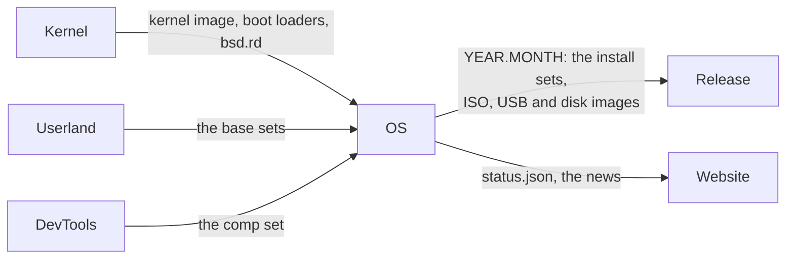

# EmiBSD OS

<p align="center">
  
</p>

<p align="center"><em>Ferffy, the EmiBSD mascot: a <a href="https://en.wikipedia.org/wiki/Lithodes_santolla">centolla</a>, the child of Ferris (Rust's crab) and Puffy (OpenBSD's pufferfish).</em></p>

<p align="center"><strong>Where an EmiBSD system is assembled, booted, compared with OpenBSD and released.</strong></p>

<p align="center">
  <a href="LICENSE"></a>
  <a href="docs/RELEASE.md"></a>
  <a href="docs/RELEASE.md"></a>
  <a href="docs/RELEASE.md"></a>
  <a href="https://www.emibsd.org"></a>
</p>

> **Not for production.** EmiBSD is an experiment. It runs only in QEMU, and its crypto,
> network and storage code is unaudited. Do not use it to protect real data or real networks.

Where an [EmiBSD](https://www.emibsd.org) system is assembled and released. `MANIFEST.toml`
pins one commit of each repository that produces part of the system; the recipes fetch them,
build where they build, assemble the install sets and the media, boot them in QEMU, compare the
result with a real OpenBSD and tag the release as `YEAR.MONTH`.

| Pinned | Contributes |
|---|---|
| [Kernel](https://github.com/EmiBSD/Kernel) | the kernel image, its boot loaders, `abi_openbsd.ko`, `bsd.rd`; today also the ramdisk and media of OpenBSD's userland |
| [Userland](https://github.com/EmiBSD/Userland) | the base system above the kernel, once it boots |
| [DevTools](https://github.com/EmiBSD/DevTools) | the `comp` set: clang, lld, libc++, rustc, cargo, `std` |

## Where it sits



The last stage of the pipeline: everything upstream builds, OS assembles, boots, compares with
a real OpenBSD and tags. The whole picture is in
[Governance](https://github.com/EmiBSD/Governance) (`docs/architecture.md`).

This repository builds nothing of its own. Pre-alpha: nothing has been released; R0, the first
milestone, is the pinned Kernel booting through its own smokes from a clean clone of this
repository (`docs/RELEASE.md`).

```
just show      # the pins and the release version
just check     # every pin exists; the OpenBSD pin matches Kernel's and LandingZone's
just fetch     # clone the pinned repositories into src/ (network)
just image     # the arm64 image, built by the pinned Kernel
just smoke     # boot it through Kernel's smokes
```

EmiBSD is not affiliated with or endorsed by the OpenBSD project. The recipes and documents
here are ISC ([LICENSE](LICENSE)); what they assemble keeps the licences of its sources.
